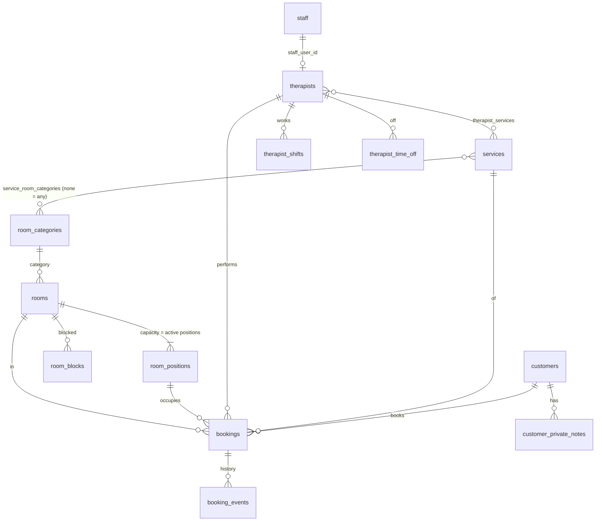

# Spa Ops — Architecture

## Stack and versions (Task 1)
- Next.js 16.4.6, React 19.3.0, Tailwind CSS 4.3.3, TypeScript 5, Node 22.20.0
- @supabase/supabase-js 2.119, @supabase/ssr 0.12, next-intl 4.14, zod 4.6
- Supabase CLI 3.1.0 (`supabase` devDependency)
- Vitest 5.1.0, Playwright 1.65.0, pg 8

## Database test harness
- `npm run test:db` runs `scripts/testdb.sh` (throwaway PostgreSQL cluster in `.testdb/`, port 54329, recreated each run, migrations applied in order) then vitest on `tests/db`.
- The cluster uses the PostgreSQL binaries bundled with the `embedded-postgres` devDependency: **PostgreSQL 18.6** (the plan asks for 16+; every test asserts `>= 160000`). See ruling R1 in the delivery notes.
- Set `TEST_DATABASE_URL` to use another empty PostgreSQL 16+ instead.

## Full Supabase stack (Task 1, Step 7)
`npx supabase init` succeeded. `npx supabase start` **failed**: `DockerLifecycleInspectError: docker: command not found (podman also not found)`. Docker/Podman is not installed on this machine, so the local Supabase stack (Auth, API) is unavailable. DB tests (Tasks 2–9) run on the throwaway cluster; Tasks 11–14 are blocked until Docker Desktop or Podman is installed.

## Data model (ERD)



## Exclusion constraints on `bookings`
All three apply only to bookings whose status is not `cancelled` or `no_show`.

| Constraint | Prevents |
|---|---|
| `bookings_therapist_no_overlap` | One therapist in two treatments at once (`service_during`). Back-to-back is allowed. |
| `bookings_position_no_overlap` | One bed/position used twice, including the room's turnover buffer (`room_during`). |
| `bookings_room_single_party` | Two different parties in the same room at once; positions of one party (a couple) may share it. |

## Lock order
`create_booking` and `move_booking` call `private.check_slot`, which takes `pg_advisory_xact_lock(hashtextextended(id::text, 0))` on the therapist and the room, **lowest uuid first**. The resource-change guard triggers (deactivation, room blocks, time off, shift shrink/delete, therapist-service delete) take the same single-resource lock, so a configuration change and a booking serialise. `move_booking` and `set_booking_status` lock the booking row (`for update`) before the advisory locks. The concurrency suite is run ten times in a row without a `40P01` deadlock.

## Error codes (SQLSTATE P0001, message equals the code)
`NOT_AUTHORIZED`, `THERAPIST_BUSY`, `POSITION_TAKEN`, `ROOM_OTHER_PARTY`, `THERAPIST_OFF_SHIFT`, `THERAPIST_TIME_OFF`, `THERAPIST_NOT_QUALIFIED`, `ROOM_BLOCKED`, `ROOM_INCOMPATIBLE`, `RESOURCE_INACTIVE`, `PAST_START`, `INVALID_TRANSITION`, `STALE_VERSION`, `CONFLICTS_WITH_BOOKINGS`.

## Permission matrix (proved by `tests/db/permissions.test.ts`)

| Statement | owner | manager | receptionist | therapist | customer | anon |
|---|---|---|---|---|---|---|
| `select from rooms` | rows | rows | rows | rows | 0 | 0 |
| `update rooms set zone='x'` | rows | rows | 0 | 0 | 0 | 0 |
| `insert into therapist_shifts …` | ok | ok | `42501` | `42501` | `42501` | `42501` |
| `select from customers` | rows | rows | rows | 0 | 1 (own) | 0 |
| `select from customer_private_notes` | rows | rows | 0 | 0 | 0 | 0 |
| `select from bookings` | rows | rows | rows | own only | own only | 0 |
| `insert into bookings …` | `42501` | `42501` | `42501` | `42501` | `42501` | `42501` |
| `select create_booking(…)` | ok | ok | ok | `NOT_AUTHORIZED` | `NOT_AUTHORIZED` | `NOT_AUTHORIZED` |
| `select booking_board(…)` | rows | rows | rows | own only | `NOT_AUTHORIZED` | `NOT_AUTHORIZED` |
| `select from audit_log` | rows | rows | 0 | 0 | 0 | 0 |
| `update staff set role='owner'` | rows | 0 | 0 | 0 | 0 | 0 |

## Full Supabase stack — update
After Docker Desktop and WSL 2 were installed, `npx supabase start` succeeded: all eight migrations apply on the real stack and `supabase/seed.sql` loads (`npx supabase db reset`). The earlier failure above (no Docker) no longer applies. Local keys go in `.env.local` (git-ignored); `.env.example` lists the variable names.

## Module map
`src/modules/<module>/{schema.ts,actions.ts,components/}`: `identity` (session, staff accounts, login), `rooms`, `catalog` (categories, services), `therapists` (shifts, time off), `customers` (picker), `booking` (allocation, calendar, create/move/status). Pages under `src/app/[locale]/(staff)` only compose them. `src/proxy.ts` (Next 16's name for middleware) handles locale routing and Supabase session refresh. Server actions return `{ ok: true, … } | { ok: false, code }`; the role check lives in `roleOrNull()` (actions) or `requireRole()` (pages).

## Final verification run (Task 14, Step 4)
```
npm run test:db          Test Files 11 passed (11) | Tests 121 passed (121)
npx vitest run src       Test Files 5 passed (5)   | Tests 10 passed (10)
npx playwright test      34 passed (2.5m)   [desktop 1440x900 + mobile 390x844]
npm run build            exit 0
npm run lint             exit 0
```
Playwright files: `auth` 6, `admin-rooms` 6, `admin-staff` 8, `booking` 14 (each test runs on both projects).

## Acceptance evidence (spec section 18, criteria met by Plan 1)

| Criterion | Proof |
|---|---|
| Owner creates staff accounts | `tests/e2e/admin-staff.spec.ts` "an owner creates a receptionist who can then sign in" |
| Six rooms is not a limit; rooms added with no code or schema change | `tests/db/rooms.test.ts` "a seventh room needs no schema change…"; `tests/db/booking-create.test.ts` "candidates follow the configured rooms…"; e2e "an owner adds a seventh room…"; "a newly added room becomes a calendar column" |
| Deactivate without losing history | `tests/db/rooms.test.ts` (no deletes); `booking-change.test.ts` "a room with only past or cancelled bookings can be deactivated and keeps its history"; e2e "deactivating a room with a future booking shows the reason…" |
| Grouping, categories and compatibility | e2e rooms grouped by zone / category filter (admin-rooms); `booking-create.test.ts` `ROOM_INCOMPATIBLE`; e2e "a manager creates a service limited to one room category" |
| Manager creates services and schedules | e2e "a manager creates a service…", "a manager adds a shift and it appears on the week grid" |
| Receptionist creates a booking | `booking-create.test.ts` "creates a confirmed booking…"; e2e "a receptionist books a new customer with a suggested therapist and room" |
| Conflicting and simultaneous bookings rejected | `booking-constraints.test.ts` (three exclusion constraints); `booking-concurrency.test.ts` (20 simultaneous, six-room race, block race; 10 consecutive clean runs); e2e "a taken slot is refused…", "double-clicking confirm creates one booking" |
| Reschedule without conflicts | `booking-change.test.ts` move tests; e2e "a manager moves a booking; a refused move leaves it in place" |
| Permissions enforced server-side | `tests/db/permissions.test.ts` (66 cells); e2e "a receptionist cannot open room administration", "a manager cannot open staff accounts", "a therapist sees only their own bookings…" |
| Desktop and mobile | every Playwright test runs on `desktop` (1440×900) and `mobile` (390×844) |

**Left to Plans 2–4:** room turnover and derived room status, Today dashboard, check-in flow, drag-and-drop and week/month calendar, realtime, notification outbox (Plan 2); customer records UI, payments, reports and CSV export, policy settings, PDPA retention (Plan 3); load test, security validation, backup/rollback runbook, production configuration (Plan 4).

**Known limitation (Task 8):** a same-day therapist absence must be handled by moving the affected bookings first, because the time-off guard refuses to overlap a live booking; Plan 2 adds an affected-bookings queue.

## How to run locally
```
npx supabase start            # needs Docker Desktop; prints the local URL and keys
# put them in .env.local (see .env.example)
npx supabase db reset         # applies migrations + seed (shifts cover the 14 days from the reset date)
npm run dev                   # http://localhost:3000/th/login   (owner@spa.test … password local-dev-only)
npm run test:db               # database tests on a throwaway PostgreSQL
npx playwright test           # browser tests (starts its own dev server on :3100)
```
Re-run `npx supabase db reset` when the seeded shifts are more than a few days old; the browser tests book "tomorrow" inside those shifts.
