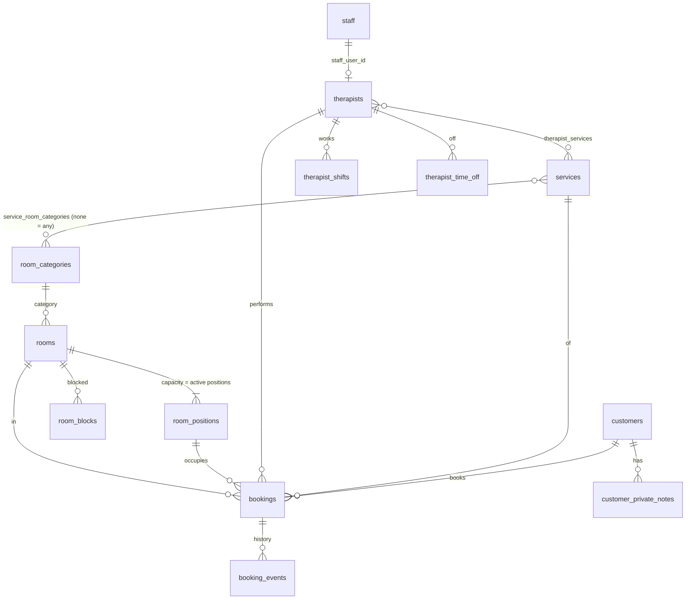
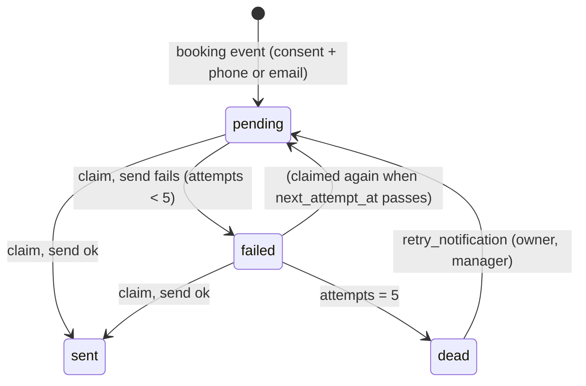
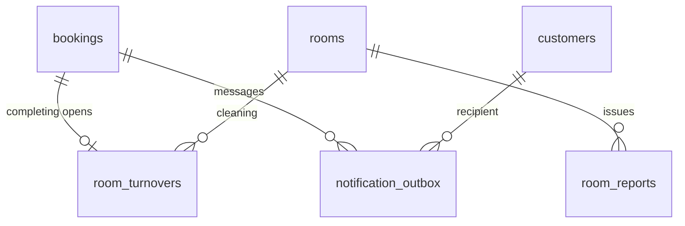
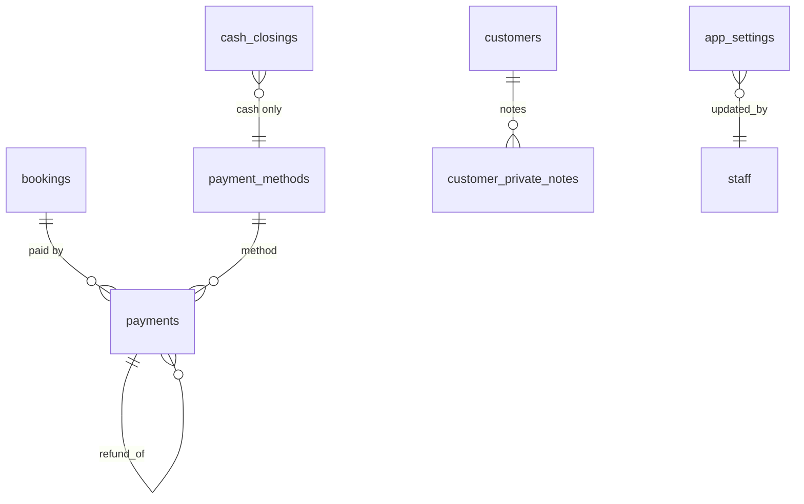

# Spa Ops — Architecture

## Stack and versions (Task 1)
- Next.js 16.4.6, React 19.3.0, Tailwind CSS 4.3.3, TypeScript 5, Node 22.20.0
- @supabase/supabase-js 2.119, @supabase/ssr 0.12, next-intl 4.14, zod 4.6
- Supabase CLI 3.1.0 (`supabase` devDependency)
- Vitest 5.1.0, Playwright 1.65.0, pg 8

## Database test harness
- `npm run test:db` runs `scripts/testdb.sh` (throwaway PostgreSQL cluster in `.testdb/`, port 54329, recreated each run, migrations applied in order) then vitest on `tests/db`.
- The cluster uses the PostgreSQL binaries bundled with the `embedded-postgres` devDependency: **PostgreSQL 18.6** (the plan asks for 16+; every test asserts `>= 160000`). See ruling R1 in the delivery notes.
- Set `TEST_DATABASE_URL` to use another empty PostgreSQL 16+ instead.

## Full Supabase stack (Task 1, Step 7)
`npx supabase init` succeeded. `npx supabase start` **failed**: `DockerLifecycleInspectError: docker: command not found (podman also not found)`. Docker/Podman is not installed on this machine, so the local Supabase stack (Auth, API) is unavailable. DB tests (Tasks 2–9) run on the throwaway cluster; Tasks 11–14 are blocked until Docker Desktop or Podman is installed.

## Data model (ERD)



## Exclusion constraints on `bookings`
All three apply only to bookings whose status is not `cancelled` or `no_show`.

| Constraint | Prevents |
|---|---|
| `bookings_therapist_no_overlap` | One therapist in two treatments at once (`service_during`). Back-to-back is allowed. |
| `bookings_position_no_overlap` | One bed/position used twice, including the room's turnover buffer (`room_during`). |
| `bookings_room_single_party` | Two different parties in the same room at once; positions of one party (a couple) may share it. |

## Lock order
`create_booking` and `move_booking` call `private.check_slot`, which takes `pg_advisory_xact_lock(hashtextextended(id::text, 0))` on the therapist and the room, **lowest uuid first**. The resource-change guard triggers (deactivation, room blocks, time off, shift shrink/delete, therapist-service delete) take the same single-resource lock, so a configuration change and a booking serialise. `move_booking` and `set_booking_status` lock the booking row (`for update`) before the advisory locks. The concurrency suite is run ten times in a row without a `40P01` deadlock.

## Error codes (SQLSTATE P0001, message equals the code)
`NOT_AUTHORIZED`, `THERAPIST_BUSY`, `POSITION_TAKEN`, `ROOM_OTHER_PARTY`, `THERAPIST_OFF_SHIFT`, `THERAPIST_TIME_OFF`, `THERAPIST_NOT_QUALIFIED`, `ROOM_BLOCKED`, `ROOM_INCOMPATIBLE`, `RESOURCE_INACTIVE`, `PAST_START`, `INVALID_TRANSITION`, `STALE_VERSION`, `CONFLICTS_WITH_BOOKINGS`.

## Permission matrix (proved by `tests/db/permissions.test.ts`)

| Statement | owner | manager | receptionist | therapist | customer | anon |
|---|---|---|---|---|---|---|
| `select from rooms` | rows | rows | rows | rows | 0 | 0 |
| `update rooms set zone='x'` | rows | rows | 0 | 0 | 0 | 0 |
| `insert into therapist_shifts …` | ok | ok | `42501` | `42501` | `42501` | `42501` |
| `select from customers` | rows | rows | rows | 0 | 1 (own) | 0 |
| `select from customer_private_notes` | rows | rows | 0 | 0 | 0 | 0 |
| `select from bookings` | rows | rows | rows | own only | own only | 0 |
| `insert into bookings …` | `42501` | `42501` | `42501` | `42501` | `42501` | `42501` |
| `select create_booking(…)` | ok | ok | ok | `NOT_AUTHORIZED` | `NOT_AUTHORIZED` | `NOT_AUTHORIZED` |
| `select booking_board(…)` | rows | rows | rows | own only | `NOT_AUTHORIZED` | `NOT_AUTHORIZED` |
| `select from audit_log` | rows | rows | 0 | 0 | 0 | 0 |
| `update staff set role='owner'` | rows | 0 | 0 | 0 | 0 | 0 |

## Full Supabase stack — update
After Docker Desktop and WSL 2 were installed, `npx supabase start` succeeded: all eight migrations apply on the real stack and `supabase/seed.sql` loads (`npx supabase db reset`). The earlier failure above (no Docker) no longer applies. Local keys go in `.env.local` (git-ignored); `.env.example` lists the variable names.

## Module map
`src/modules/<module>/{schema.ts,actions.ts,components/}`: `identity` (session, staff accounts, login), `rooms`, `catalog` (categories, services), `therapists` (shifts, time off), `customers` (picker), `booking` (allocation, calendar, create/move/status). Pages under `src/app/[locale]/(staff)` only compose them. `src/proxy.ts` (Next 16's name for middleware) handles locale routing and Supabase session refresh. Server actions return `{ ok: true, … } | { ok: false, code }`; the role check lives in `roleOrNull()` (actions) or `requireRole()` (pages).

## Final verification run (Task 14, Step 4)
```
npm run test:db          Test Files 11 passed (11) | Tests 121 passed (121)
npx vitest run src       Test Files 5 passed (5)   | Tests 10 passed (10)
npx playwright test      34 passed (2.5m)   [desktop 1440x900 + mobile 390x844]
npm run build            exit 0
npm run lint             exit 0
```
Playwright files: `auth` 6, `admin-rooms` 6, `admin-staff` 8, `booking` 14 (each test runs on both projects).

## Acceptance evidence (spec section 18, criteria met by Plan 1)

| Criterion | Proof |
|---|---|
| Owner creates staff accounts | `tests/e2e/admin-staff.spec.ts` "an owner creates a receptionist who can then sign in" |
| Six rooms is not a limit; rooms added with no code or schema change | `tests/db/rooms.test.ts` "a seventh room needs no schema change…"; `tests/db/booking-create.test.ts` "candidates follow the configured rooms…"; e2e "an owner adds a seventh room…"; "a newly added room becomes a calendar column" |
| Deactivate without losing history | `tests/db/rooms.test.ts` (no deletes); `booking-change.test.ts` "a room with only past or cancelled bookings can be deactivated and keeps its history"; e2e "deactivating a room with a future booking shows the reason…" |
| Grouping, categories and compatibility | e2e rooms grouped by zone / category filter (admin-rooms); `booking-create.test.ts` `ROOM_INCOMPATIBLE`; e2e "a manager creates a service limited to one room category" |
| Manager creates services and schedules | e2e "a manager creates a service…", "a manager adds a shift and it appears on the week grid" |
| Receptionist creates a booking | `booking-create.test.ts` "creates a confirmed booking…"; e2e "a receptionist books a new customer with a suggested therapist and room" |
| Conflicting and simultaneous bookings rejected | `booking-constraints.test.ts` (three exclusion constraints); `booking-concurrency.test.ts` (20 simultaneous, six-room race, block race; 10 consecutive clean runs); e2e "a taken slot is refused…", "double-clicking confirm creates one booking" |
| Reschedule without conflicts | `booking-change.test.ts` move tests; e2e "a manager moves a booking; a refused move leaves it in place" |
| Permissions enforced server-side | `tests/db/permissions.test.ts` (66 cells); e2e "a receptionist cannot open room administration", "a manager cannot open staff accounts", "a therapist sees only their own bookings…" |
| Desktop and mobile | every Playwright test runs on `desktop` (1440×900) and `mobile` (390×844) |

**Left to Plans 2–4:** room turnover and derived room status, Today dashboard, check-in flow, drag-and-drop and week/month calendar, realtime, notification outbox (Plan 2); customer records UI, payments, reports and CSV export, policy settings, PDPA retention (Plan 3); load test, security validation, backup/rollback runbook, production configuration (Plan 4).


## How to run locally
```
npx supabase start            # needs Docker Desktop; prints the local URL and keys
# put them in .env.local (see .env.example)
npx supabase db reset         # applies migrations + seed (shifts cover the 14 days from the reset date)
npm run dev                   # http://localhost:3000/th/login   (owner@spa.test … password local-dev-only)
npm run test:db               # database tests on a throwaway PostgreSQL
npx playwright test           # browser tests (starts its own dev server on :3100)
```
Re-run `npx supabase db reset` when the seeded shifts are more than a few days old; the browser tests book "tomorrow" inside those shifts.

---

# Plan 2 — Daily operations

Migrations 0009–0012; screens `/today`, `/rooms`, week and month calendar, drag-and-drop, live updates, customer message outbox. No real message provider is connected (see "Not built").

## Room status (derived, never stored)
`room_status_board(p_now, p_reserved_lead_min)` returns one row per active room. The first rule that matches wins:

| # | Status | Rule |
|---|---|---|
| 1 | `occupied` | a booking in the room is `in_treatment` (even if a block or the schedule says otherwise) |
| 2 | `out_of_service` | a `maintenance` or `closed` block contains `p_now` |
| 3 | `cleaning` | an open `room_turnovers` row, or a `cleaning` block contains `p_now` |
| 4 | `reserved` | a booking is `checked_in`, or a `requested`/`confirmed` booking starts within the lead time (30 min) and has not ended |
| 5 | `available` | otherwise |

There is no writable status column. The only manual levers are: mark ready, add or remove a block, report an issue.

## Start-of-treatment rules (`set_booking_status`)
Checked in this order after the version, transition and role checks. Physical reality is enforced when a treatment starts; the schedule is never rewritten automatically.

| Transition | Effect |
|---|---|
| `→ checked_in` | `checked_in_at = now()` |
| `→ in_treatment` | locks therapist and room (lowest uuid first); `ROOM_NOT_READY` if the room has an open turnover or an `in_treatment` booking of a different party; `THERAPIST_BUSY` if the therapist has another `in_treatment` booking; `started_at = now()` |
| `→ completed` | `completed_at = now()`; finishing early shortens `service_during` (and `room_during` to now + turnover); if no other booking in the room is `in_treatment`, opens a turnover due at now + the room's `turnover_min` |

A couple (same `party_id`) share the room: the turnover opens only when the last partner completes.

## Turnover lifecycle
`completed` (last partner) → open `room_turnovers` row (room status `cleaning`) → `mark_room_ready(room)` by any active staff member (including therapists) → `ready_at`, `ready_by` set; the booking's `room_during` is trimmed so the room is offered again. `private.room_busy_now` makes `create_booking`/`move_booking` refuse a start within 5 minutes in a room that is being cleaned or still occupied (`ROOM_NOT_READY`), and `available_candidates` leaves such rooms out.

## Exceptions
`record_absence` and `force_room_block` (owner, manager) insert time off / a block even over live bookings and return the affected booking ids; `stranded_bookings()` lists them (`therapist_time_off` or `room_blocked`) until someone moves them. Direct inserts still raise `CONFLICTS_WITH_BOOKINGS`. Room issues: `report_room_issue` (any staff), `resolve_room_report` (owner, manager, receptionist).

## Customer message outbox

A claim sets `attempts + 1` and hides the row for 5 minutes (visibility timeout), so a crashed sender's message becomes claimable again. A sent message is never claimed or completed again.

| Attempt that failed | Next attempt after |
|---|---|
| 1 | 1 minute |
| 2 | 5 minutes |
| 3 | 30 minutes |
| 4 | 120 minutes |
| 5 | none: status `dead` (manual retry) |

Rows hold only `{booking_id, starts_at}`; the contact is looked up at send time. Texts never mention the service, therapist, room or business type. `POST /api/internal/dispatch` (Bearer `CRON_SECRET`) runs the dispatcher with a log-only sender.

## Data model additions


## Permission matrix additions (database)

| Object | owner | manager | receptionist | therapist | customer | anon |
|---|---|---|---|---|---|---|
| `room_turnovers`, `room_reports` select | rows | rows | rows | rows | 0 | 0 |
| `mark_room_ready`, `report_room_issue` | ok | ok | ok | ok | `NOT_AUTHORIZED` | `NOT_AUTHORIZED` |
| `resolve_room_report`, `stranded_bookings` | ok | ok | ok | `NOT_AUTHORIZED` | `NOT_AUTHORIZED` | `NOT_AUTHORIZED` |
| `record_absence`, `force_room_block` | ok | ok | `NOT_AUTHORIZED` | `NOT_AUTHORIZED` | `NOT_AUTHORIZED` | `NOT_AUTHORIZED` |
| `room_status_board`, `booking_day_counts` | rows | rows | rows | own names only | `NOT_AUTHORIZED` | `NOT_AUTHORIZED` |
| `notification_outbox` select / `retry_notification` | rows / ok | rows / ok | 0 / `NOT_AUTHORIZED` | 0 / `NOT_AUTHORIZED` | 0 | 0 |
| `claim_notifications`, `complete_notification` | `42501` | `42501` | `42501` | `42501` | `42501` | `42501` (service role only) |

## Acceptance evidence (spec section 18, completed by Plan 2)

| Criterion | Proof |
|---|---|
| Employees can check customers in and update treatment progress | `tests/db/ops-turnover.test.ts` "each step stamps its time"; e2e `today.spec.ts` "a walk-in goes from arrival to a ready room on one screen", "a therapist runs their own treatment from a phone and cannot cancel" |
| Treatment completion correctly updates the room turnover workflow | `ops-turnover.test.ts` "completing opens one turnover…", "a shared room is cleaned only after the last partner finishes", "a treatment cannot start in a room that is being cleaned…", "finishing early frees the therapist…"; `room-status.test.ts` "status follows the booking through the day" |
| Room readiness updates the operational dashboard | `room-status.test.ts`; e2e `rooms.spec.ts` "a tile follows the room through occupied, cleaning and ready"; `live.spec.ts` "room tiles follow a status change made elsewhere" |
| Scalable room dashboard | e2e `rooms.spec.ts` "forty more rooms stay searchable, filterable and grouped"; `rooms.test.ts` |
| Exceptions are visible and recoverable | `exceptions.test.ts`; e2e `exceptions.spec.ts` (sick day, forced closure, room report) |
| Screens update without reload; offline is shown | e2e `live.spec.ts` |
| Calendar can be dragged, and shows week and month | e2e `drag.spec.ts`, `calendar-span.spec.ts`; unit `drop.test.ts`, `month.test.ts` |
| Failed integrations are recoverable | `notifications.test.ts` (claim timeout, back-off, dead, retry); `dispatch.test.ts`; e2e `notifications.spec.ts` |

## Still to do
- **Plan 3 (now built, see "Plan 3 — Business management" below):** customer records UI, payments and reconciliation, reports and CSV export, owner-editable policy settings (the `OPS_DEFAULTS` thresholds and the room-status lead time moved there), PDPA retention and anonymisation.
- **Plan 4:** load test with dozens of rooms, security validation, full end-to-end hardening, backup/rollback runbook, production configuration.
- **Not built in Plan 2:** reminders before an appointment (only confirmed/changed/cancelled messages exist) and any real message provider (SMS, LINE, email). Connecting one costs money and needs the owner's approval; it only has to implement `Sender` in `src/modules/notifications/dispatch.ts`.

## Final verification run (Plan 2, Task 12 Step 5)
```
npm run test:db          Test Files 16 passed (16) | Tests 201 passed (201)
npx vitest run src       Test Files 11 passed (11) | Tests 29 passed (29)
npx playwright test      79 passed, 3 skipped (9.4m)   [desktop 1440x900 + mobile 390x844; drag specs skip on mobile]
npm run build            exit 0
npm run lint             exit 0
```

---

# Plan 3 — Business management

Migrations 0013–0018; screens `/admin/settings`, `/payments`, `/customers`, `/customers/[id]`, `/reports`; payment dialog on Today and in the calendar panel; CSV and JSON downloads. No payment provider is integrated: the system **records** what happened at the desk, it never moves money (see "Not built").

## Owner-editable settings (`app_settings`, migration 0013)
The key list, defaults and limits live once, in `private.setting_spec()`. `set_setting` (owner only) refuses anything else with `INVALID_SETTING`; `get_settings` (any active staff) returns every key with its stored value or default. Changes are audited with the owner as actor.

| Key | Default | Allowed | Used by |
|---|---|---|---|
| `ops.arrival_window_min` | 60 | integer 5–240 | Today: arrivals list |
| `ops.late_arrival_min` | 10 | integer 1–120 | Today: late arrival flag |
| `ops.ending_soon_min` | 10 | integer 1–60 | Today: ending soon flag |
| `ops.room_prep_warn_min` | 15 | integer 1–120 | Today: overdue room flag |
| `ops.reserved_lead_min` | 30 | integer 0–240 | `room_status_board` (a null argument means this setting) |
| `policy.cancel_free_min` | 120 | integer 0–10080 | cancellation fee |
| `policy.cancel_fee_percent` | 0 | integer 0–100 | cancellation fee |
| `policy.no_show_fee_percent` | 0 | integer 0–100 | no-show fee |
| `payments.receptionist_can_record` | true | boolean | `record_payment` |
| `reports.manager_can_view` | true | boolean | every report function, the nav link, the CSV route |
| `retention.inactive_months` | 24 | integer 6–120 | `retention_candidates` |

## What a booking costs, and fees (migration 0014)
Price and discount live on the booking. `private.booking_charge` is the one definition of the amount owed: the stored `fee_satang` once a booking is `cancelled` or `no_show`, otherwise `price - discount`.

* On `→ cancelled`, if `now()` is later than `start - policy.cancel_free_min` minutes, the fee is `round((price - discount) × policy.cancel_fee_percent / 100)`; earlier cancellations are free.
* On `→ no_show`, the fee is `round((price - discount) × policy.no_show_fee_percent / 100)`.
* **The fee is stored once, when the status changes, and never recalculated.** Editing the policy later changes nothing already charged (`charges.test.ts` "a fee already charged does not change…").
* `adjust_booking_charge` (owner, manager) sets a discount and / or overrides the fee, always with a reason, with a version check; it writes a `charge_adjusted` event.

## Payment ledger (migration 0015)
`payments` is **append-only**: no role has an insert, update or delete policy; rows change only through `SECURITY DEFINER` functions, and every change is audited.

| Rule | Behaviour |
|---|---|
| Record | `record_payment` locks the booking row, returns the existing row for a repeated `idempotency_key` (a double tap is one payment), refuses `OVERPAYMENT` above the amount due, `INVALID_AMOUNT`, `RESOURCE_INACTIVE` (inactive method) |
| Card data | `CARD_DATA_REFUSED` when the reference or note contains a 13–19 digit run (spaces and dashes allowed) that passes the Luhn check. Ordinary 16-digit references that fail Luhn are kept |
| Verification | A method with `needs_verification` (bank transfer, PromptPay) is stored unverified; only `verify_payment` (owner, manager) verifies it. Cash is verified at once. Recording a transfer is never treated as proof of payment |
| Void | `void_payment` (owner, manager) needs a reason and is refused if refunds still point at the payment; the row stays, marked voided |
| Refund | `record_refund` (owner, manager) inserts a `refund` row pointing at the original payment; `REFUND_EXCEEDS_PAYMENT` when it would exceed the payment minus earlier refunds |
| Who | owner and manager always; receptionist while `payments.receptionist_can_record` is true; therapists never see money |

Status is derived by `booking_money` (voided rows ignored; `net = paid - refunded`; `due = charge - net`):

| Status | Rule |
|---|---|
| `not_due` | charge 0 and nothing paid |
| `refunded` | charge 0, something was paid, net 0 |
| `overpaid` | net > charge (a refund is owed; shown in `pending_payments` as a negative due) |
| `unpaid` | charge > 0, net 0 |
| `partial` | 0 < net < charge |
| `paid` | net = charge, charge > 0 |

`payment_day_summary` and `close_cash_day` give the daily reconciliation: totals per method (recorded, verified, awaiting verification, refunded, voided), and a cash count against the expected cash of that Bangkok day. The screen warns when cash moved after the day was closed.

## Customer records and privacy (migration 0016)
`customers` gains `service_notes` (treatment preferences) and `anonymised_at`; the phone is stored in one normalised form (`^(0\d{8,9}|\+\d{6,15})$`), unique. Therapists have no access to the table: `booking_detail` gives them the booking note and the treatment notes for **their own bookings only**, never contact details.

**Anonymisation** (`anonymise_customer`, owner only, typed name + reason, irreversible; refused while a live future booking exists):

| Removed | Kept |
|---|---|
| display name (→ "Removed"), full name, phone, email, login link, preferred therapist, treatment notes, consent | bookings and their status, times, rooms, therapists, services |
| private notes (the one deliberate hard delete in the system) | payments and refunds |
| booking notes, and the `note` key inside booking events and booking audit rows | the audit trail of what happened, with the customer's personal values blanked |
| old / new values of the customer's audit rows | one `ANONYMISE` audit row holding only the reason |
| pending or failed messages (set to `dead`) | |

`export_customer` (owner, manager) returns the profile, private notes, bookings and payments as JSON. `retention_candidates` (owner) only **lists** customers with no activity for `retention.inactive_months`; nothing is anonymised by itself.

## Reports (migrations 0017 and 0018)
All report functions are `SECURITY DEFINER`, restricted to the owner and to managers while `reports.manager_can_view` is true. A "day" is a Bangkok calendar day. Screens, CSV headers and these tables use the same words.

| Metric | Definition |
|---|---|
| Booked revenue | For bookings whose service starts in the period: price − discount of **completed** bookings, plus `fee_satang` of **cancelled** and **no-show** bookings. A rescheduled booking is one booking, counted on the day it finally starts |
| Collected revenue | Non-voided `payment` rows received in the period |
| Refunded | Non-voided `refund` rows received in the period |
| Net collected | Collected − refunded. Verification does not change these; money awaiting verification is shown separately in reconciliation |
| Average transaction value | Booked revenue of completed bookings ÷ completed bookings (fees excluded) |
| Cancellation rate / no-show rate | Cancelled (no-show) ÷ all bookings starting in the period |
| Reschedules | `rescheduled` events on bookings starting in the period |
| Customers / returning rate | Customers with a completed booking in the period; the share who had a completed booking before their first one in the period |
| Revenue by service / by therapist | Completed bookings only; fees are not attributed; inactive services and therapists still appear when they have completed bookings in the period |
| Open minutes | Minutes in the period covered by at least one therapist shift (union of all shifts) |
| Room utilisation | Booked room minutes ÷ (open minutes − maintenance or closed block minutes on that room inside open time). Booked room minutes = service time of bookings not cancelled or no-show |
| Therapist utilisation | Booked minutes ÷ (shift minutes − time-off minutes inside shifts) |
| Turnover efficiency | For turnovers started in the period: average minutes from start to ready, and the share marked ready at or before the due time |
| Peak periods | Bookings not cancelled or no-show, by ISO weekday (1 = Monday) and hour of the Bangkok start time |

Report rows come from the rooms, therapists and services configured in the database: a new room appears in the next report, a retired room with bookings in the period stays. CSV files start with a UTF-8 byte-order mark (Thai text opens correctly in Excel), end lines with CRLF, and prefix a text cell that starts with `=`, `+`, `-`, `@`, tab or carriage return with an apostrophe so a name like `=1+1` cannot run as a formula.

## Data model additions

New tables: `app_settings`, `payment_methods`, `payments`, `cash_closings`. `bookings` gains `fee_satang` and `charge_reason`; `customers` gains `service_notes` and `anonymised_at`.

## Permission matrix additions (database)

| Object | owner | manager | receptionist | therapist | customer | anon |
|---|---|---|---|---|---|---|
| `app_settings` select / `get_settings` | rows / ok | rows / ok | rows / ok | rows / ok | 0 / `NOT_AUTHORIZED` | 0 / `NOT_AUTHORIZED` |
| `set_setting` | ok | `NOT_AUTHORIZED` | `NOT_AUTHORIZED` | `NOT_AUTHORIZED` | `NOT_AUTHORIZED` | `NOT_AUTHORIZED` |
| `payments`, `cash_closings` select | rows | rows (cash_closings: rows) | payments: rows; cash_closings: 0 | 0 | 0 | 0 |
| `record_payment` | ok | ok | ok while allowed | `NOT_AUTHORIZED` | `NOT_AUTHORIZED` | `NOT_AUTHORIZED` |
| `verify_payment`, `void_payment`, `record_refund`, `payment_day_summary`, `close_cash_day`, `adjust_booking_charge` | ok | ok | `NOT_AUTHORIZED` | `NOT_AUTHORIZED` | `NOT_AUTHORIZED` | `NOT_AUTHORIZED` |
| `booking_money`, `pending_payments` | ok | ok | ok | `NOT_AUTHORIZED` | `NOT_AUTHORIZED` | `NOT_AUTHORIZED` |
| `customer_summary` | ok | ok | ok | `NOT_AUTHORIZED` | `NOT_AUTHORIZED` | `NOT_AUTHORIZED` |
| `booking_detail` | ok | ok | ok | own bookings only | `NOT_AUTHORIZED` | `NOT_AUTHORIZED` |
| `export_customer` | ok | ok | `NOT_AUTHORIZED` | `NOT_AUTHORIZED` | `NOT_AUTHORIZED` | `NOT_AUTHORIZED` |
| `anonymise_customer`, `retention_candidates` | ok | `NOT_AUTHORIZED` | `NOT_AUTHORIZED` | `NOT_AUTHORIZED` | `NOT_AUTHORIZED` | `NOT_AUTHORIZED` |
| every `report_*` function | ok | ok while allowed | `NOT_AUTHORIZED` | `NOT_AUTHORIZED` | `NOT_AUTHORIZED` | `NOT_AUTHORIZED` |

Every cell is proved by `tests/db/permissions-money.test.ts` (25 statements × 6 actors = 150 cells); the behaviour behind them by `payments.test.ts`, `settings.test.ts`, `charges.test.ts`, `customer-privacy.test.ts`, `reports-money.test.ts` and `reports-ops.test.ts`. Two details: `cash_closings` is readable by owner and manager only, and a receptionist reads `payments` but not `cash_closings`.

## Acceptance evidence (spec section 18, completed by Plan 3)

| Criterion | Proof |
|---|---|
| Payments can be recorded and reconciled | `payments.test.ts` (cash, partial, transfer awaiting verification, idempotent key, void, refund, day summary and cash closing); e2e `payments.spec.ts`, `reconciliation.spec.ts` |
| Daily revenue reports reflect actual recorded transactions | `reports-money.test.ts` ("booked revenue sits on the service day; collected and refunded on the day money moved", "summary: one definition per number"); e2e `reports.spec.ts` "daily revenue reflects what was actually recorded" (a voided payment lowers the figure) |
| Users cannot access actions or information beyond their permissions (manager part) | `reports-money.test.ts` "reports are for the owner, and for managers only while allowed"; `payments.test.ts` "therapists see no money; reception can be switched off"; `customer-privacy.test.ts` "a therapist reads treatment notes for their own booking only"; e2e `reports.spec.ts` "managers lose reports…", `customers.spec.ts` "managers can add private notes but not anonymise…", `settings.spec.ts` "a manager cannot open settings" |
| Cancellation and no-show policies | `charges.test.ts`; e2e `settings.spec.ts` |
| Card data is not stored | `payments.test.ts` "card numbers are refused…"; e2e `payments.spec.ts` "typing a card number is refused in plain words" |
| Customer data protection tools | `customer-privacy.test.ts` (export, anonymise, retention list); e2e `customers.spec.ts` |
| Spreadsheet export is safe | `csv.test.ts`; e2e `reports.spec.ts` ("spreadsheet-safe CSV", "a service named like a formula…") |

## Not built / limits
* **PDPA compliance still needs a legal review before production.** This plan builds the tools (consent record with date, export, anonymisation, retention list); it does not decide what must be kept or deleted.
* **No payment provider is integrated.** Payments are recorded by staff; transfers and PromptPay are marked unverified until a manager checks them against the bank. Connecting a provider costs money and needs the owner's approval.
* **Audit-log retention is not limited yet:** the audit log keeps growing and is not pruned.
* Receipts / tax invoices, discount rules beyond a manual amount, and tips are not built.

## Still to do for Plan 4
Load test with dozens of rooms, security validation (including the new payment and privacy functions), end-to-end hardening, backup and rollback runbook, production configuration, audit-log retention, and review of the report queries' performance on a year of data.
