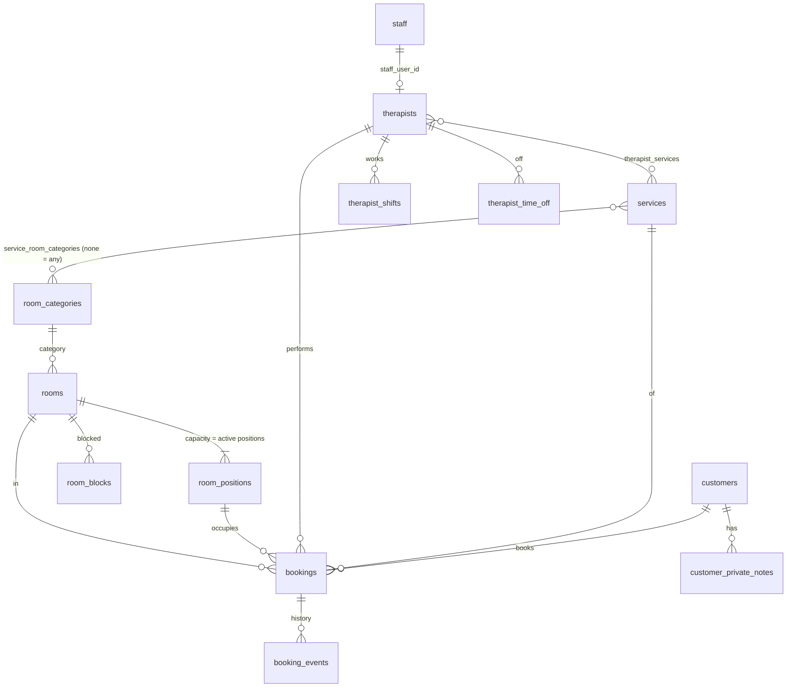

# Spa Ops — Architecture

## Stack and versions (Task 1)
- Next.js 16.4.6, React 19.3.0, Tailwind CSS 4.3.3, TypeScript 5, Node 22.20.0
- @supabase/supabase-js 2.119, @supabase/ssr 0.12, next-intl 4.14, zod 4.6
- Supabase CLI 3.1.0 (`supabase` devDependency)
- Vitest 5.1.0, Playwright 1.65.0, pg 8

## Database test harness
- `npm run test:db` runs `scripts/testdb.sh` (throwaway PostgreSQL cluster in `.testdb/`, port 54329, recreated each run, migrations applied in order) then vitest on `tests/db`.
- The cluster uses the PostgreSQL binaries bundled with the `embedded-postgres` devDependency: **PostgreSQL 18.6** (the plan asks for 16+; every test asserts `>= 160000`). See ruling R1 in the delivery notes.
- Set `TEST_DATABASE_URL` to use another empty PostgreSQL 16+ instead.

## Full Supabase stack (Task 1, Step 7)
`npx supabase init` succeeded. `npx supabase start` **failed**: `DockerLifecycleInspectError: docker: command not found (podman also not found)`. Docker/Podman is not installed on this machine, so the local Supabase stack (Auth, API) is unavailable. DB tests (Tasks 2–9) run on the throwaway cluster; Tasks 11–14 are blocked until Docker Desktop or Podman is installed.

## Data model (ERD)

## Exclusion constraints on `bookings`
All three apply only to bookings whose status is not `cancelled` or `no_show`.

| Constraint | Prevents |
|---|---|
| `bookings_therapist_no_overlap` | One therapist in two treatments at once (`service_during`). Back-to-back is allowed. |
| `bookings_position_no_overlap` | One bed/position used twice, including the room's turnover buffer (`room_during`). |
| `bookings_room_single_party` | Two different parties in the same room at once; positions of one party (a couple) may share it. |

## Lock order
`create_booking` and `move_booking` call `private.check_slot`, which takes `pg_advisory_xact_lock(hashtextextended(id::text, 0))` on the therapist and the room, **lowest uuid first**. The resource-change guard triggers (deactivation, room blocks, time off, shift shrink/delete, therapist-service delete) take the same single-resource lock, so a configuration change and a booking serialise. `move_booking` and `set_booking_status` lock the booking row (`for update`) before the advisory locks. The concurrency suite is run ten times in a row without a `40P01` deadlock.

## Error codes (SQLSTATE P0001, message equals the code)
`NOT_AUTHORIZED`, `THERAPIST_BUSY`, `POSITION_TAKEN`, `ROOM_OTHER_PARTY`, `THERAPIST_OFF_SHIFT`, `THERAPIST_TIME_OFF`, `THERAPIST_NOT_QUALIFIED`, `ROOM_BLOCKED`, `ROOM_INCOMPATIBLE`, `RESOURCE_INACTIVE`, `PAST_START`, `INVALID_TRANSITION`, `STALE_VERSION`, `CONFLICTS_WITH_BOOKINGS`.

## Permission matrix (proved by `tests/db/permissions.test.ts`)

| Statement | owner | manager | receptionist | therapist | customer | anon |
|---|---|---|---|---|---|---|
| `select from rooms` | rows | rows | rows | rows | 0 | 0 |
| `update rooms set zone='x'` | rows | rows | 0 | 0 | 0 | 0 |
| `insert into therapist_shifts …` | ok | ok | `42501` | `42501` | `42501` | `42501` |
| `select from customers` | rows | rows | rows | 0 | 1 (own) | 0 |
| `select from customer_private_notes` | rows | rows | 0 | 0 | 0 | 0 |
| `select from bookings` | rows | rows | rows | own only | own only | 0 |
| `insert into bookings …` | `42501` | `42501` | `42501` | `42501` | `42501` | `42501` |
| `select create_booking(…)` | ok | ok | ok | `NOT_AUTHORIZED` | `NOT_AUTHORIZED` | `NOT_AUTHORIZED` |
| `select booking_board(…)` | rows | rows | rows | own only | `NOT_AUTHORIZED` | `NOT_AUTHORIZED` |
| `select from audit_log` | rows | rows | 0 | 0 | 0 | 0 |
| `update staff set role='owner'` | rows | 0 | 0 | 0 | 0 | 0 |
